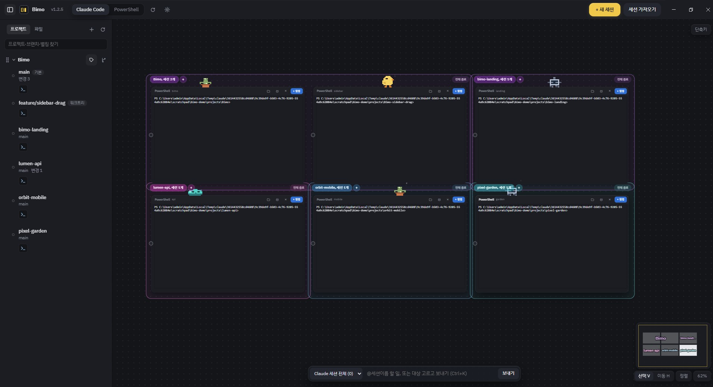
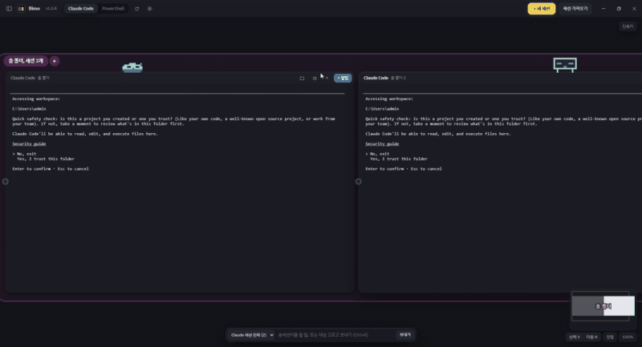
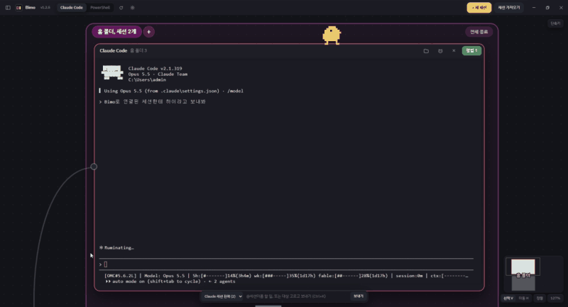
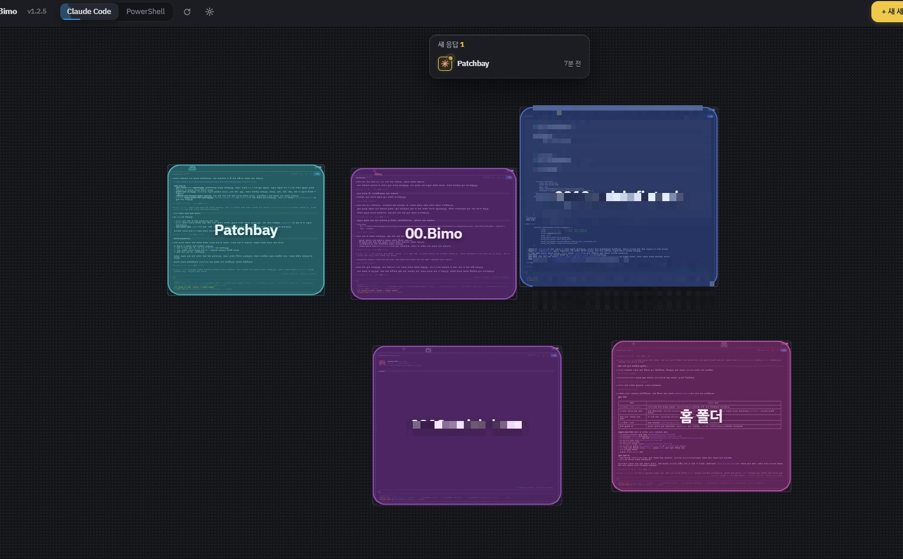
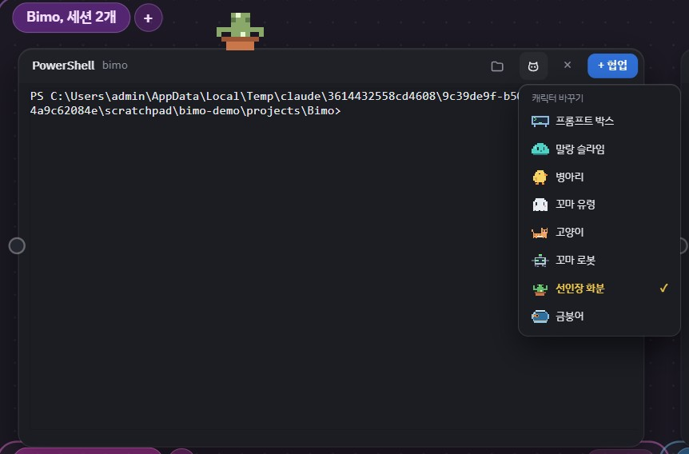
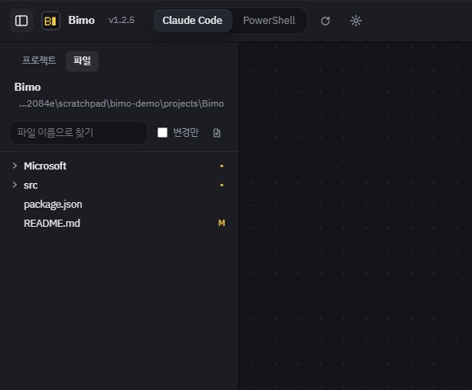

<p align="center"></p>

<h1 align="center">Bimo</h1>

<p align="center">A desktop app that lays out your AI coding CLI terminals on an infinite board to run them side by side</p>

<p align="center">
  <a href="README.md">한국어</a> · <b>English</b>
</p>

<p align="center">
  
</p>

Running Claude Code, Codex, and other AI CLIs across multiple projects quickly piles up terminal windows. Bimo arranges those terminals as interactive cards on an infinite canvas, showing at a glance which sessions are working and which have finished answering.

## Features

- **Infinite Canvas Board** — Place sessions as cards and freely drag or resize them. Includes minimap, zoom controls, and auto-arrange by folder.
<p align="center">
  
</p>

- **Session Collaboration (MCP)** — Connect sessions with a visual cable so Claude instances can talk and delegate tasks to each other. Bimo automatically attaches an internal MCP server (`list_sessions`, `send_to_session`). Secured via `127.0.0.1` and fresh launch tokens.
<p align="center">
  
</p>

- **Status Indicators & Response Alerts** — Card border colors highlight working, answered, or failed states. Includes a dedicated list and badges for unread responses.
<p align="center">
  
</p>

- **Pixel Character Avatars** — Assign cute pixel art characters (chick, slime, cat, cactus pot, robot, goldfish, etc.) to each session card for instant visual identification.
<p align="center">
  
</p>

- **AI CLI Auto-Detection** — Automatically discovers and lists only installed CLIs in the launcher:
  Claude Code · Codex · Gemini · Qwen Code · OpenCode · Aider · Cursor · Copilot · Amp (PowerShell is always available).
- **Multilingual Support (i18n)** — Full out-of-the-box UI and notification support for both English and Korean.
- **Resume Sessions** — Drag and drop an AI conversation log from another terminal onto the board to resume right where you left off.
- **Project Sidebar** — Group sessions by project folder, assign color tags, and launch directly on specific git branches.
- **Quick Send (Broadcast)** — Type `@session-name task` to dispatch input directly to any session (`Ctrl+K`).
- **In-Board File Explorer** — Search and open project files directly on the board with Markdown preview.
<p align="center">
  
</p>

- **Terminal Utilities** — Clipboard image pasting, clickable OSC 8 hyperlinks, and drag-to-select even in mouse-mode CLI apps.
- **Auto-Updates** — Checks and downloads the latest releases automatically via GitHub Releases.

## Installation

Download the latest prebuilt binaries from [Releases](https://github.com/Gyun-hub/bimo/releases).

| OS | Package |
|---|---|
| Windows (x64) | `Bimo-Setup-<version>.exe` |
| macOS (Apple Silicon / Intel) | `.dmg` |

- Windows installers are not code-signed; Windows SmartScreen may show a warning. Click "More info → Run anyway".
- macOS builds are also not signed/notarized. On first launch, right-click the app and choose "Open". (Auto-updates are not supported on macOS).

> **Note**: Install your desired AI CLIs separately (e.g., `npm i -g @anthropic-ai/claude-code`). Bimo automatically locates CLIs registered in your system `PATH`.

## Data Storage

| Path | Description |
|---|---|
| `%APPDATA%\Bimo\board.json` (Windows) / `~/Library/Application Support/Bimo` (macOS) | Board layouts and session states |
| `Local Storage` within the same directory | Application settings |

You can customize the storage directory by setting the `BIMO_USER_DATA` environment variable.

## Development & Build

Requires Node.js 22+.

```bash
npm install
npm start                 # Run local development mode
npm run smoke             # Launch default board, take screenshot (%TEMP%\bimo-smoke.png) and exit
npm run dist:win          # Build Windows installer → release/
npm run dist:mac          # Build macOS dmg/zip (on macOS)
```

The app icon is generated as 16×16 pixel art via `tools/make-icon.py` (requires Pillow).

```bash
python -I tools/make-icon.py   # Generates build/icon.png · icon.ico · icon.icns
```

### Release Automation

Bumping `version` in `package.json` and merging into `main` automatically triggers `.github/workflows/release.yml`, which compiles Windows/macOS binaries and publishes a GitHub Release.

### Tech Stack

Electron · xterm.js · node-pty (`@lydell/node-pty`) · CodeMirror 5 · marked + DOMPurify · electron-builder · electron-updater

## License

[MIT](LICENSE)
