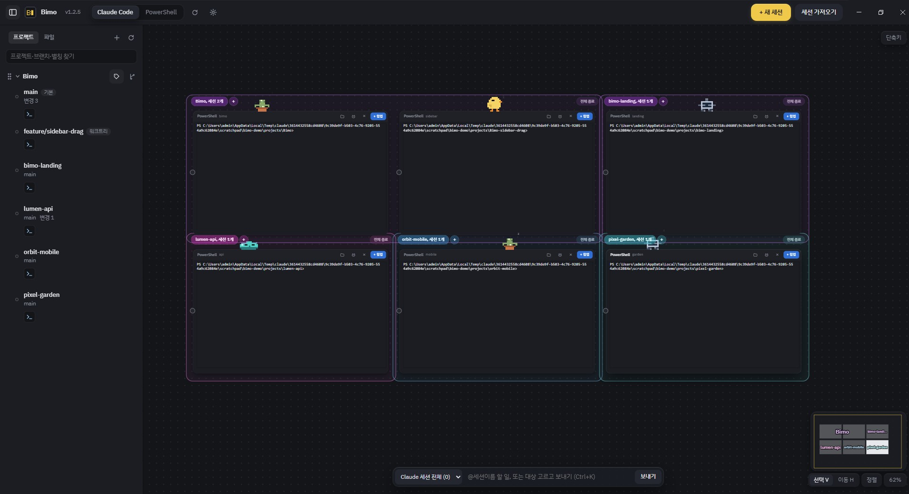
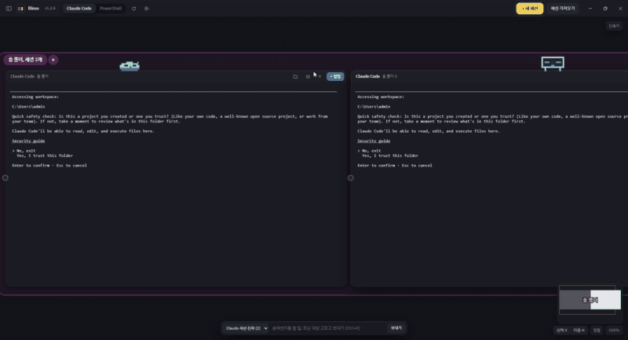
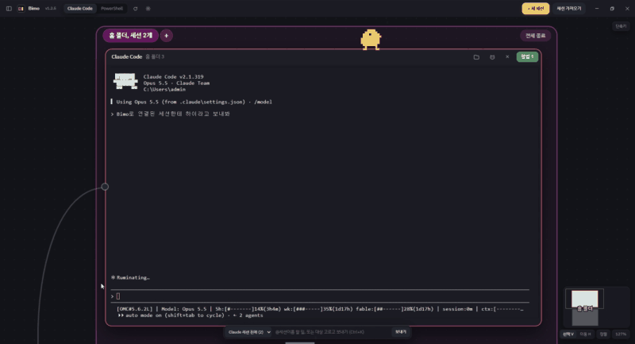
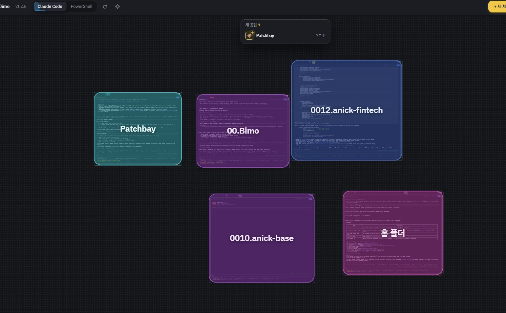
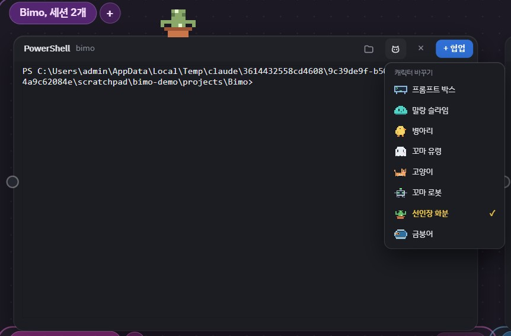
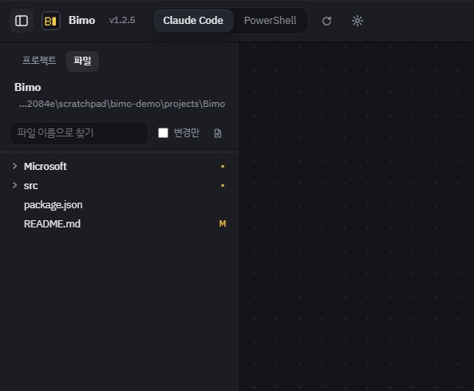

<p align="center"></p>

<h1 align="center">Bimo</h1>

<p align="center">AI 코딩 CLI 터미널을 한 보드 위에 펼쳐 두고 같이 굴리는 데스크톱 앱</p>

<p align="center">한국어 · <a href="README.en.md">English</a></p>

<p align="center">
  
</p>

여러 프로젝트에서 Claude Code · Codex 같은 AI CLI 를 동시에 돌리면 터미널 창이 금방 쌓인다. Bimo 는 그 터미널들을 무한 보드 위의 카드로 놓고, 어떤 세션이 일하는 중인지·답이 끝났는지를 한눈에 보여 준다.

## 기능

- **무한 캔버스 보드** — 세션을 카드로 놓고 끌어서 자유롭게 배치. 미니맵, 확대·축소(줌), 폴더별 자동 정렬.
<p align="center">
  
</p>

- **세션끼리 협업 (MCP)** — 케이블로 연결한 세션끼리 Claude 가 서로 대화하며 협업. 내장 `bimo` MCP 서버(`list_sessions`, `send_to_session`)가 연결된 세션 간 메시지 전송 및 작업 위임을 지원. 접속은 `127.0.0.1` + 실행마다 새로 생성되는 토큰 기반 보안.
<p align="center">
  
</p>

- **상태 표시 & 응답 알림** — 작업 중 / 응답 완료 / 실패를 카드 테두리 색상으로 직관적 표시. 확인하지 않은 새 응답 목록과 배지 제공.
<p align="center">
  
</p>

- **세션 캐릭터 커스텀** — 세션마다 귀여운 픽셀 캐릭터(병아리, 슬라임, 고양이, 선인장 화분, 로봇 등)를 지정해 시각적으로 손쉽게 구분.
<p align="center">
  
</p>

- **AI CLI 자동 감지** — 설치된 CLI 만 런처에 노출.
  Claude Code · Codex · Gemini · Qwen Code · OpenCode · Aider · Cursor · Copilot · Amp (PowerShell 은 항상 지원)
- **세션 이어 열기** — 다른 터미널에서 진행하던 AI 대화를 보드로 끌어다 놓으면 즉시 이어서 실행.
- **프로젝트 사이드바** — 폴더별 세션 그룹화, 프로젝트별 색상 지정, Git 브랜치 지정 실행.
- **빠른 전송 (Broadcast)** — `@세션이름 할 일` 로 원하는 세션에 즉시 입력 전달 (`Ctrl+K`).
- **보드 내 파일 탐색** — 보드 안에서 바로 파일 찾기·열기 및 Markdown 미리보기.
<p align="center">
  
</p>

- **터미널 편의 기능** — 클립보드 캡처 이미지 붙여넣기, OSC 8 링크 열기, 마우스 모드 앱에서도 드래그 텍스트 선택 지원.
- **자동 업데이트** — GitHub Releases 를 통해 최신 버전 자동 감지 및 다운로드.

## 설치

[Releases](https://github.com/Gyun-hub/bimo/releases) 에서 최신 빌드를 다운로드합니다.

| OS | 파일 |
|---|---|
| Windows (x64) | `Bimo-Setup-<버전>.exe` |
| macOS (Apple Silicon / Intel) | `.dmg` |

- Windows 설치본은 코드 서명이 없어 SmartScreen 경고가 뜰 수 있습니다. "추가 정보 → 실행"을 누르면 정상 실행됩니다.
- macOS 빌드 역시 서명·공증이 적용되어 있지 않습니다. 처음 열 때 우클릭 → 열기를 선택해 주세요. (macOS 환경에서는 자동 업데이트가 동작하지 않습니다.)

> **참고**: AI CLI 는 사전에 개별 설치되어 있어야 합니다 (예: `npm i -g @anthropic-ai/claude-code`). Bimo 는 시스템 `PATH` 에 등록된 CLI 를 자동으로 찾아 실행합니다.

## 데이터 저장 경로

| 위치 | 내용 |
|---|---|
| `%APPDATA%\Bimo\board.json` (Windows) / `~/Library/Application Support/Bimo` (macOS) | 보드 레이아웃 및 세션 정보 |
| 같은 폴더 내 `Local Storage` | 앱 설정 |

`BIMO_USER_DATA` 환경 변수를 지정하여 데이터 저장 폴더를 임의로 변경할 수 있습니다 (테스트용 독립 보드 등).

## 개발 및 빌드

Node.js 22 환경을 권장합니다.

```bash
npm install
npm start                 # 로컬 개발 모드 실행
npm run smoke             # 기본 보드로 실행 후 스크린샷(%TEMP%\bimo-smoke.png) 저장 및 자동 종료 테스트
npm run dist:win          # Windows 설치 파일 빌드 → release/
npm run dist:mac          # macOS dmg/zip 빌드 (macOS 환경)
```

앱 아이콘은 `tools/make-icon.py` 스크립트를 통해 16×16 픽셀 아트로 자동 생성됩니다 (Pillow 필요).

```bash
python -I tools/make-icon.py   # build/icon.png · icon.ico · icon.icns 생성
```

### 릴리스 자동화

`package.json` 의 `version` 을 올린 후 `main` 브랜치에 머지하면, `.github/workflows/release.yml` 이 실행되어 Windows 및 macOS 설치본을 자동으로 빌드하고 `v<버전>` GitHub Release 로 배포합니다.

### 기술 스택

Electron · xterm.js · node-pty (`@lydell/node-pty`) · CodeMirror 5 · marked + DOMPurify · electron-builder · electron-updater

## 라이선스

[MIT](LICENSE)
